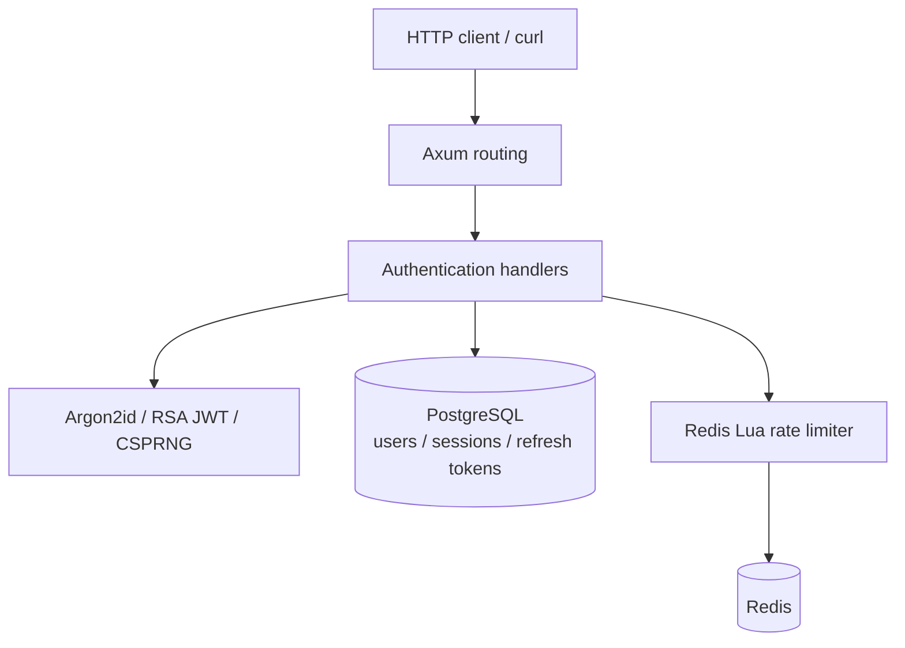

<div align="center">

# AuthCore

**A security-minded, API-only authentication backend written in Rust.**

A self-hosted authentication learning project exploring credential security, RSA-signed JWTs, refresh-token rotation, and revocable sessions.


**[Get started](#getting-started) · [Features](#features) · [API](#api-reference) · [Security](#security-design) · [Roadmap](#roadmap)**

</div>

> [!WARNING]
> **Experimental, not production-ready.** The core API is exercised in GitHub Actions with real PostgreSQL and Redis; this does **not** validate the live Google/Resend provider flows or constitute a professional security audit. Do not protect production accounts with this code yet.

## Overview

AuthCore is a backend-only portfolio project. Its purpose is to make complex authentication flows explicit and testable rather than hiding them behind a managed identity provider. There is no frontend or dashboard.

The initial source implementation includes registration, password login, JWT access tokens, opaque refresh tokens, database-backed sessions, and rate limiting. Google OpenID Connect and single-use password reset code have also been added, but **the external Google and Resend provider flows have not been verified with real credentials**. See the [roadmap](#roadmap).

## Features

| Component | Implementation status |
| --- | --- |
| Local registration, email verification and password login | Implemented; CI covers database flow |
| Argon2id password hashing | Implemented in source; verification pending |
| RS256 JWT access tokens (15-minute lifetime) | Implemented in source; verification pending |
| 30-day opaque refresh tokens (SHA-256 hashes in DB) | Implemented in source; verification pending |
| Transactional refresh rotation and replay-triggered revocation | Implemented in source; verification pending |
| PostgreSQL session inspection and revocation | Implemented in source; verification pending |
| Change password and invalidate sessions | Implemented in source; verification pending |
| Redis Lua rate limiting and fail-closed on Redis errors | Implemented in source; verification pending |
| OpenAPI 3 spec at `/openapi.json` | Added; validation pending |
| Docker Compose and GitHub Actions | Added; verification pending |
| Email verification with single-use tokens and resend | Implemented; live Resend delivery unverified |
| Google OAuth2 / OIDC + PKCE + state-cookie binding | Implemented in source; external provider testing pending |
| One-time password reset, optional Resend delivery | Implemented in source; external delivery testing pending |
| RSA signing-key rotation with multiple active `kid` values | Planned |
| Independent security audit and load benchmarks | Planned |

## Architecture



The code is intentionally small and split by responsibility:

```text
src/
  main.rs         # Startup and HTTP listener
  lib.rs          # Router definition
  state.rs        # App configuration, database and Redis clients, JWT keys
  handlers.rs     # HTTP authentication endpoints and transactional session logic
  security.rs     # Argon2id, JWTs, opaque refresh tokens, validation
  limiter.rs      # Atomic rate limiting via Redis Lua\n  oauth.rs        # Google OIDC flow, PKCE and JWKS validation\n  recovery.rs     # Password reset and mail delivery adapter
  verification.rs # Email verification
  error.rs        # Sanitized API errors
migrations/       # PostgreSQL schema
openapi.json      # OpenAPI document
scripts/          # Developer key generation
.github/workflows # Format, clippy, tests, HTTP smoke test
compose.yaml      # API + PostgreSQL + Redis
Dockerfile        # Multistage Rust container build
```

## Getting started

Requirements: **Docker + Docker Compose + OpenSSL** for the container path, or a current Rust toolchain plus PostgreSQL and Redis for native execution.

### Docker Compose

```bash
git clone https://github.com/PLNastalli/AuthCore.git
cd AuthCore
sh scripts/dev-keys.sh
# On Linux/macOS, make the Docker API process match the signing-key owner:
export AUTHCORE_UID="$(id -u)"
export AUTHCORE_GID="$(id -g)"
docker compose up --build
```

The example Compose stack binds the API to `127.0.0.1:3000`; PostgreSQL and Redis are private to the Compose network. On Windows, the sample UID/GID defaults usually work with Docker Desktop bind mounts; if file access fails, configure the two `AUTHCORE_*` variables for your environment. The example credentials and signing keys are **development-only**.

> [!NOTE]
> The CI builds the Docker image and exercises the API natively, but a release container still needs provider credentials for complete user onboarding. Do not expose the development Compose stack publicly.

### Recommended: local development without a mail provider

For a **fully testable password API without configuring Resend**, run the database services in Docker and the Rust API in debug mode, bound to loopback:

```bash
git clone https://github.com/PLNastalli/AuthCore.git
cd AuthCore
docker compose -f compose.yaml -f compose.dev.yaml up -d postgres redis
cp .env.example .env
sh scripts/dev-keys.sh
cargo run --locked
```

The example `.env` enables a **debug-only** email-verification bypass restricted to localhost, so registration and login work for development. The bypass does not exist in release mode. Use Git Bash/WSL for the shell script on Windows.

`docker compose up --build` instead uses a **release** binary. Without Resend credentials, its registration endpoint intentionally returns 503; health and readiness remain available. Do not expose either development setup publicly.

### Native Rust execution

First start your own PostgreSQL and Redis and generate local RSA keys:

```bash
cp .env.example .env
sh scripts/dev-keys.sh
cargo run
```

On Windows use Git Bash or WSL to run the shell script, or create a 3072-bit RSA key pair with OpenSSL and place it at the paths referenced by `.env`.

The server runs SQLx migrations at startup. It refuses startup when PostgreSQL, Redis, or the configured key files are unavailable.

## External identity and email configuration

**Release password registration requires email delivery.** Accounts must verify their email with a one-time token before password login. Without a configured mail provider, release registration returns HTTP 503.

For local integration tests, debug builds support `AUTHCORE_DEV_SKIP_EMAIL_VERIFICATION=true` only with a server bound to loopback and a localhost origin. Release binaries reject the bypass; never deploy debug binaries publicly.

**Google login:** configure `GOOGLE_CLIENT_ID`, `GOOGLE_CLIENT_SECRET` and `GOOGLE_REDIRECT_URI` together. The callback URI must exactly match `PUBLIC_ORIGIN/api/v1/oauth/google/callback` and be registered in Google Cloud. Visit `GET /api/v1/oauth/google/start` in a browser to begin the flow. The callback returns tokens as JSON and sets the refresh cookie; it does not create a frontend. Accounts sharing an existing local email are **not linked automatically**. See [the OIDC integration guide](docs/GOOGLE_OIDC.md).

**Verification:** after registration, submit `{"token":"..."}` to `POST /api/v1/auth/verify-email`. Use `POST /api/v1/auth/resend-verification` to request a fresh token.

**Password recovery:** set `RESEND_API_KEY` and `RESET_FROM_EMAIL` (a verified sender domain). Without both values, the recovery request endpoint returns 503; it never puts reset tokens in API responses or logs. The email includes a one-time token to submit to `POST /api/v1/auth/reset-password`. See [the recovery guide](docs/PASSWORD_RECOVERY.md).

The implementations are written and compile-tested, but **real provider integrations require separate end-to-end verification and are not audited**.

## API reference

The full machine-readable contract lives in [openapi.json](openapi.json).

| Method | Endpoint | Description |
| --- | --- | --- |
| `POST` | `/api/v1/auth/register` | Register a local account |
| `POST` | `/api/v1/auth/verify-email` | Confirm email ownership with one-time token |
| `POST` | `/api/v1/auth/resend-verification` | Request another verification token |
| `POST` | `/api/v1/auth/login` | Obtain JWT and refresh cookie |
| `POST` | `/api/v1/auth/refresh` | Rotate refresh cookie and issue new JWT |
| `GET` | `/api/v1/auth/me` | Get current account |
| `POST` | `/api/v1/auth/logout` | Revoke the current session |
| `POST` | `/api/v1/auth/logout-all` | Revoke all sessions |
| `POST` | `/api/v1/auth/change-password` | Change password and invalidate sessions |
| `GET` | `/api/v1/auth/sessions` | List active sessions (up to 100) |
| `DELETE` | `/api/v1/auth/sessions/{id}` | Revoke one session |
| `GET` | `/health` | Liveness |
| `GET` | `/ready` | PostgreSQL and Redis readiness |
| `GET` | `/openapi.json` | OpenAPI specification |

**Sample flow** (requires the server to be running):

```bash
# Register
curl -X POST http://localhost:3000/api/v1/auth/register \
  -H "Content-Type: application/json" \
  -d '{"email":"dev@example.com","password":"replace-with-a-strong-unique-password"}'

# Login. Store the refresh cookie in a local file.
curl -c cookies.txt -X POST http://localhost:3000/api/v1/auth/login \
  -H "Content-Type: application/json" \
  -d '{"email":"dev@example.com","password":"replace-with-a-strong-unique-password"}'

# Use the JWT from login response:
curl http://localhost:3000/api/v1/auth/me \
  -H "Authorization: Bearer ACCESS_TOKEN"

# Rotate refresh cookie; Origin is required for cookie-authenticated refresh.
curl -b cookies.txt -c cookies.txt \
  -H "Origin: http://localhost:3000" \
  -X POST http://localhost:3000/api/v1/auth/refresh
```

Access tokens are passed explicitly as `Authorization: Bearer`. Refresh tokens use a dedicated `HttpOnly` cookie. The service does **not** accept refresh tokens from request bodies or query strings.

Read the [engineering review](docs/ENGINEERING_REVIEW.md) for the security findings, the reviewed dependency-audit exception and the remaining gaps.

## Security design

- **Password storage:** Argon2id with a random salt; hashing and verification run off the async executor.
- **Access credentials:** JWT signed with a locally configured RSA private key; expiration, issuer, audience, algorithm and token type checked on read.
- **Session enforcement:** even a correctly signed JWT fails when its associated database session is revoked.
- **Refresh rotation:** a PostgreSQL transaction locks the session before consuming the presented refresh-token hash and storing its replacement. Reuse of a consumed token revokes the session.
- **Cookie policy:** `HttpOnly`, `SameSite=Strict`, `Path=/` and `Secure` in production; `__Host-` prefix when secure cookies are enabled. Development permits non-secure cookies **only on localhost**.
- **CSRF protection:** the cookie-authenticated refresh operation requires an `Origin` matching configured `PUBLIC_ORIGIN`.
- **Abuse prevention:** Redis Lua scripts atomically increment counters and apply TTLs. Requests are rejected when Redis is unavailable.
- **No frontend:** the API supports direct HTTP clients; no client UI is provided.

### Known limitations

This is a portfolio project, not a replacement for an audited identity provider.

- OAuth2/OpenID Connect code and Resend reset-email delivery have been added, but cannot be verified end-to-end without external test credentials. Email ownership is not yet verified during registration.
- Key rotation and a multi-key JWKS publishing strategy are not present.
- OAuth account linking is intentionally restricted: existing local accounts cannot be silently linked just because an external provider presents the same email.
- IP-based rate limits use the direct socket peer, so deployment behind a reverse proxy requires a trusted-proxy policy.
- Generic login errors are returned, but the missing-account path still needs work to reduce timing differences.
- There is no established threat-model review, penetration test, security audit, benchmark report, or production operations manual.
- Dependency versions are committed in `Cargo.lock` for reproducible builds.

Do **not** interpret an unchecked feature or an example shell command as proof of production readiness.

## Development and tests

```bash
cargo fmt --all -- --check
cargo clippy --all-targets -- -D warnings
cargo test --all-targets
```

GitHub Actions also has a PostgreSQL/Redis-backed HTTP smoke test for registration, login, `/me` and refresh rotation. See [the CI workflow](.github/workflows/ci.yml). Check the actual [Actions results](https://github.com/PLNastalli/AuthCore/actions); do not assume they are green.

## Roadmap

- [x] Implement initial HTTP routes, migrations, JWT and session code
- [x] Add Redis rate-limit code, containers, OpenAPI and CI configuration
- [ ] Confirm clean compilation and passing CI
- [ ] Add realistic end-to-end/concurrent-refresh integration tests
- [x] Implement password reset token lifecycle and optional Resend delivery adapter\n- [ ] Verify actual email delivery and implement verified-email onboarding
- [x] Add Google OpenID Connect code with Authorization Code + PKCE, JWKS and state binding\n- [ ] Verify full Google login with test OAuth credentials
- [ ] Add versioned RSA key rotation, hardened deployment configuration and metrics
- [ ] Conduct external security review and publish reproducible load benchmarks

## Inspiration

Documentation style and engineering direction were informed by [Ory Kratos](https://github.com/ory/kratos), [Supabase Auth](https://github.com/supabase/auth), [ZITADEL](https://github.com/zitadel/zitadel), and [axum-login](https://github.com/maxcountryman/axum-login). AuthCore is an independent project; their security assurances do not extend to this code.

## License

Distributed under the [MIT License](LICENSE). See the license file for terms.

---

<div align="center"><sub>Backend engineering is proven by tested behavior, not claims.</sub></div>
