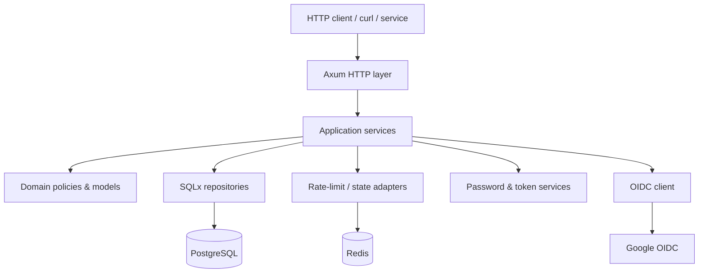
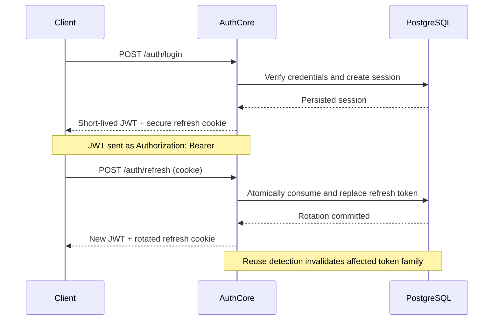

<div align="center">

# AuthCore

**A security-first, API-only authentication service built with Rust.**

A self-hostable backend for identities, signed access tokens, refresh-token rotation, and OpenID Connect — designed to make authentication internals understandable, testable, and observable.


**[Vision](#why-authcore) · [Architecture](#architecture) · [API](#api-design) · [Security](#security-model) · [Roadmap](#implementation-roadmap)**

</div>

> [!IMPORTANT]
> **Project status: design phase.** The repository currently contains this project specification, **not a working authentication server**. The APIs, guarantees, components, and commands described below are **design targets**, not implemented or security-audited features. Do not use AuthCore to secure a production application yet.

## Why AuthCore?

Authentication is much more than generating a JWT. Real systems must handle credential storage, concurrent token rotation, revocation, account recovery, external identity providers, rate limits, database failures, and security-sensitive logging.

**AuthCore** is a backend engineering portfolio project focused on building those capabilities explicitly — without a frontend, admin dashboard, or client framework.

The goals are to:

- **Build secure foundations:** password hashing, token validation, replay detection, and session controls.
- **Keep the design inspectable:** modular Rust services with clear boundaries between HTTP, application logic, domain rules, and infrastructure.
- **Make behavior verifiable:** real PostgreSQL integration tests, concurrency tests, CI, and reproducible benchmarks.
- **Stay API-first:** documented HTTP endpoints, OpenAPI schemas, and `curl` examples instead of a bundled UI.
- **Be honest about readiness:** publish tested implementations incrementally and never call unfinished features production-ready.

## Intended capabilities

| Area | Planned capabilities |
| --- | --- |
| Credentials | Email/password registration, sign-in, Argon2id, password changes, account recovery |
| Access tokens | Short-lived, asymmetrically signed JWTs with strict claim and algorithm validation |
| Sessions | Per-device sessions, logout, global revocation, session inspection |
| Refresh tokens | Opaque high-entropy tokens, hashed storage, one-time rotation, replay detection |
| Federation | Google sign-in via OAuth 2.0 Authorization Code + PKCE and OpenID Connect |
| Abuse prevention | Distributed rate limits, login-attempt controls, conservative failure behavior |
| Persistence | PostgreSQL, SQLx migrations, constraints, indexes, and transactional updates |
| Operations | Redis, structured tracing, health/readiness checks, Docker Compose, CI |
| Documentation | Versioned REST API, OpenAPI, examples, and security design notes |

All items above are **planned** until code and tests land.

## Technology choices

| Component | Technology | Reason |
| --- | --- | --- |
| Language | Rust | Explicit error handling, memory safety, predictable resource usage |
| HTTP server | Axum + Tower | Composable handlers, middleware, and request extraction |
| Async runtime | Tokio | Asynchronous I/O and concurrency primitives |
| Data storage | PostgreSQL + SQLx | Transactions, integrity constraints, typed query support |
| Distributed controls | Redis | Rate limiting and short-lived coordination/state |
| Passwords | Argon2id | Memory-hard password hashing |
| API contract | OpenAPI 3.x + utoipa | Discoverable, versioned HTTP interface |
| Observability | tracing | Structured logs and request correlation |
| Delivery | Docker Compose + GitHub Actions | Reproducible local services and automated verification |

Dependency versions and implementation details will be pinned during the first working release.

## Architecture

The target design keeps framework code at the edges and security policy in the application/domain layers.



### Proposed source layout

```text
authcore/
├── src/
│   ├── main.rs                  # process startup
│   ├── lib.rs                   # application composition
│   ├── config/                  # validated runtime configuration
│   ├── domain/                  # users, sessions, invariants
│   ├── application/             # auth use cases
│   ├── infrastructure/
│   │   ├── database/            # SQLx persistence
│   │   ├── redis/               # distributed controls
│   │   ├── security/            # Argon2id, JWT, refresh tokens
│   │   └── oauth/               # OIDC integration
│   └── http/
│       ├── routes/
│       ├── handlers/
│       ├── middleware/
│       └── dto/
├── migrations/                  # versioned PostgreSQL schema
├── tests/                       # integration and adversarial tests
├── benches/                     # reproducible load measurements
├── docs/                        # threat model and design decisions
├── .github/workflows/           # CI checks
├── Dockerfile
├── compose.yaml
├── .env.example
└── README.md
```

This structure is a **proposal**. Modules will be created only when the implementation needs them; unnecessary abstraction is explicitly out of scope.

## API design

Versioned endpoints are planned under `/api/v1`. Request/response schemas, status codes, and error formats will be specified in OpenAPI as features are implemented.

| Method | Route | Purpose | Status |
| --- | --- | --- | --- |
| `POST` | `/api/v1/auth/register` | Create an account | Planned |
| `POST` | `/api/v1/auth/login` | Authenticate with credentials | Planned |
| `POST` | `/api/v1/auth/refresh` | Rotate session credentials | Planned |
| `POST` | `/api/v1/auth/logout` | Revoke current session | Planned |
| `POST` | `/api/v1/auth/logout-all` | Revoke all sessions | Planned |
| `POST` | `/api/v1/auth/change-password` | Update password | Planned |
| `POST` | `/api/v1/auth/forgot-password` | Initiate account recovery | Planned |
| `POST` | `/api/v1/auth/reset-password` | Complete account recovery | Planned |
| `GET` | `/api/v1/auth/me` | Inspect current identity | Planned |
| `GET` | `/api/v1/auth/sessions` | List active sessions | Planned |
| `DELETE` | `/api/v1/auth/sessions/{id}` | Revoke one session | Planned |
| `GET` | `/api/v1/oauth/google/start` | Start OIDC authorization | Planned |
| `GET` | `/api/v1/oauth/google/callback` | Handle OIDC callback | Planned |
| `GET` | `/health` | Process liveness | Planned |
| `GET` | `/ready` | Dependency readiness | Planned |
| `GET` | `/openapi.json` | Machine-readable API schema | Planned |

### Intended token lifecycle



The sequence above is a **design diagram**, not evidence of a running implementation.

## Security model

Authentication is security-critical software. The implementation will explicitly cover these invariants:

**Passwords**
- Hash with Argon2id using tuned, documented parameters.
- Never store plaintext passwords or expose hashes via HTTP responses.
- Return generic responses where account enumeration is a risk.

**Access tokens**
- Use asymmetric JWT signatures and explicit algorithm allowlists.
- Validate signature, issuer, audience, expiry, token type, and key identifier.
- Keep access tokens short-lived. Support key rotation and documented revocation semantics.

**Refresh tokens and sessions**
- Generate cryptographically random, opaque refresh tokens.
- Store only token hashes; rotate on every accepted refresh.
- Guarantee single use using database transactions/atomic state changes.
- Detect replay and revoke the affected token family.
- Use `HttpOnly`, `Secure`, appropriately scoped cookies and `SameSite` policy.
- Enforce CSRF and Origin defenses wherever cookie authentication is relevant.

**Federated identity**
- Use Authorization Code + PKCE, `state`, `nonce`, and vetted OIDC libraries.
- Validate provider-signed ID tokens against trusted JWKS, issuer, audience, and expiry.
- Avoid unsafe automatic linking of accounts solely by matching an email address.

**Operational controls**
- Parameterized SQL, strict input validation, explicit CORS rules, request limits, and timeouts.
- Distributed abuse protections that do not silently fail open.
- Redact credentials, reset links, and tokens from logs and traces.
- Do not roll your own cryptographic primitives.

> [!CAUTION]
> A correct README does not constitute a security audit. Before any production deployment, AuthCore will require completed tests, independent review, safe operational defaults, and a vulnerability-response process.

## Getting started

**Not available yet.** There is currently no executable Rust application, `Cargo.toml`, Compose environment, or published container image in this repository.

The first runnable milestone will provide:

1. A Rust application that exposes `/health` and `/ready`.
2. A sample environment configuration with placeholder values only.
3. PostgreSQL and Redis services in Docker Compose.
4. Database migrations, tests, and copy-paste local startup commands.
5. The first fully documented authentication endpoint.

This section will be replaced with **verified** commands after the application bootstrap is merged. No commands are presented as working until tested.

## Verification strategy

AuthCore will use automated checks as evidence of behavior, rather than badges or unverified performance claims.

| Test class | Examples |
| --- | --- |
| Unit | Domain invariants, input validation, password rules |
| Integration | PostgreSQL schema, transactions, Redis rate limits |
| Auth security | Invalid/expired JWTs, logout, revocation, reset-token replay |
| Concurrency | Simultaneous refresh requests must not mint two valid successors |
| OIDC | Invalid `state`/`nonce`, JWKS changes, forged provider tokens |
| Failure modes | Redis outage, database unavailability, timeouts, denied access |
| Performance | Documented request profile, machine specs, throughput and p50/p95/p99 |

The CI pipeline is planned to run `cargo fmt`, `cargo clippy`, `cargo test`, and dependency security checks. **No passing CI status is claimed yet.**

## Implementation roadmap

- [ ] **M1 — Foundation:** application bootstrap, config, routing, migrations, CI, health checks
- [ ] **M2 — Credentials:** registration, Argon2id hashing, login, user profile
- [ ] **M3 — Sessions:** JWT validation, opaque refresh tokens, atomic rotation, revocation
- [ ] **M4 — Abuse protection:** Redis-backed limits, lockout controls, safe degradation
- [ ] **M5 — Account recovery:** password reset and session invalidation
- [ ] **M6 — Federation:** Google OIDC with PKCE and safe account linking
- [ ] **M7 — Release readiness:** OpenAPI, Docker, reproducible benchmarks, security review

Each milestone is complete only when its functionality is implemented, tested, and documented.

## Non-goals

For the initial releases, AuthCore will **not** include:

- A frontend, admin dashboard, or bundled client application.
- A homegrown OAuth/OIDC authorization server.
- Unverified claims of certification, compliance, production readiness, or performance.
- Extra layers or abstractions without an implementation need.

## Engineering decisions to document

As the project grows, design decisions will be recorded in `docs/`:

- Session consistency and refresh-token replay handling.
- Redis vs PostgreSQL responsibilities and outage behavior.
- JWT key rotation and the limits of stateless revocation.
- OAuth account linking and callback security.
- Operational tradeoffs and benchmark methodology.

## Contributing

The project is in its initial design stage. Feedback on the API contract, threat model, and architecture is welcome through GitHub issues.

Once the first executable milestone lands, this section will include the contribution workflow, local setup, coding conventions, and test requirements.

## References and inspiration

AuthCore is an independent educational/portfolio implementation. Its documentation structure and engineering emphasis are informed by mature open-source identity projects:

- [Ory Kratos](https://github.com/ory/kratos) — headless identity infrastructure and developer guidance.
- [Supabase Auth](https://github.com/supabase/auth) — authentication API, configuration, and operations.
- [ZITADEL](https://github.com/zitadel/zitadel) — API-first identity platform and getting-started documentation.
- [axum-login](https://github.com/maxcountryman/axum-login) — Rust/Axum authentication and authorization patterns.

AuthCore does not copy implementation code from these projects and does not claim equivalent features or assurance.

## License

**Not selected yet.** Public visibility alone does not grant an open-source software license. A `LICENSE` file will be added once the project's licensing decision is made.

---

<div align="center">

**Built to learn the difficult parts of backend authentication — and prove them with tests.**

</div>
